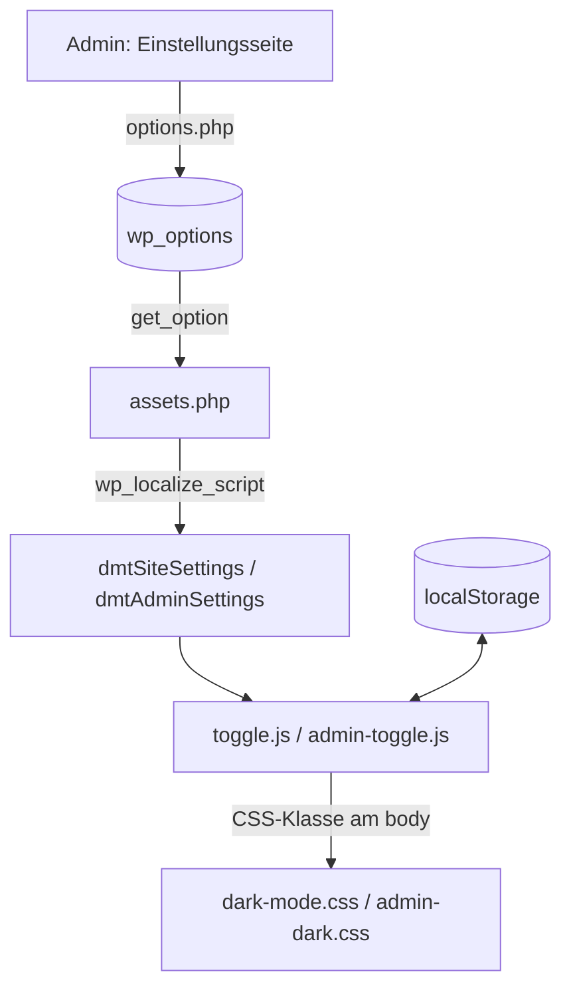
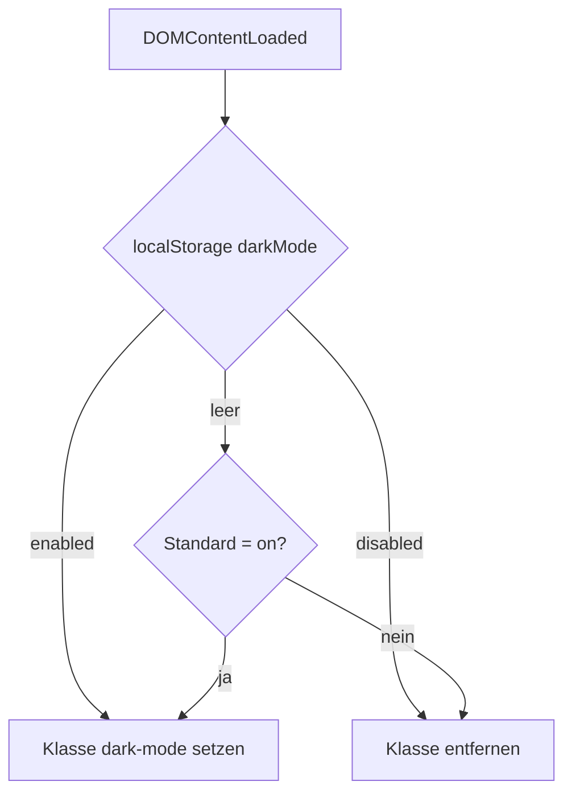

# Architektur

[← Zurück zur README](../README.md)

## Überblick

Das Plugin ist modular aufgebaut: Die Hauptdatei lädt alle PHP-Dateien aus `includes/`. Diese registrieren WordPress-Hooks für Einstellungen und Assets. Der eigentliche Umschaltmechanismus läuft clientseitig in JavaScript, indem eine CSS-Klasse am `<body>` gesetzt wird.

## Komponenten

| Komponente | Datei | Aufgabe |
|---|---|---|
| Loader | `dark-mode-toggle.php` | Plugin-Header, `require_once` aller `includes/*.php`, Laden der Übersetzungen |
| Assets | `includes/assets.php` | Einbinden von CSS/JS (Frontend und Admin), Übergabe der Optionen per `wp_localize_script`, Ausgabe der Buttons |
| Einstellungen | `includes/settings.php` | Optionsseite, Registrierung der Optionen |
| Frontend-Skript | `js/toggle.js` | Setzt/entfernt Klasse `dark-mode`, Button `#darkModeToggle` |
| Admin-Skript | `js/admin-toggle.js` | Setzt/entfernt Klasse `admin-dark`, Button `#adminDarkToggle` |
| Styles | `css/dark-mode.css`, `css/admin-dark.css` | Darstellung des Dark Mode (Inhalt hier nicht ausgewertet) |
| Übersetzung | `languages/dark-mode-toggle.pot` | Vorlage für Übersetzungen |

## Datenfluss

## Ablauf der Moduswahl (Frontend)

Im Admin gilt: `adminDarkMode = enabled` oder (Standard `on` und kein gespeicherter Wert) aktiviert die Klasse `admin-dark`. Beim Ausschalten wird der Eintrag entfernt, daher greift danach wieder der Standard.

## Besonderheiten

- Die Buttons werden per `wp_footer` bzw. `admin_footer` mit Inline-Styles ausgegeben.
- Im Admin wird zusätzlich `toggle.js` geladen (Annahme: unbeabsichtigt).
